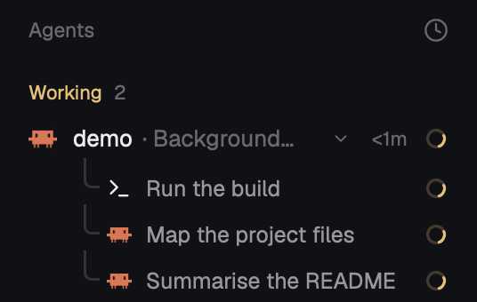

# Lookout

A Herdr desktop mod. It shows each Claude Code subagent and each background shell in the Agents list.

> [!WARNING]
> Lookout supports only Claude Code. Other harnesses and their subagents do not show.



- Each subagent and each background shell gets its own herdr-core terminal. Its parent is the Claude Code terminal.
- The terminal shows the live work: the prompt, the tool calls, the short tool results and the replies. A shell shows its output.
- The list shows a spinner while the work runs. The row shows the task description.
- Click a row to peek at it over the current tab. To keep it in its own tab, click **keep** in the peek.
- A terminal closes 2 minutes after its work stops. When you keep it in a tab, it stays until you close the tab.

## Where sub-agents show

Click the icon at the top right of the Agents list. Under **Show sub-agents**, select one:

- **Under their parent**: an indented list below the parent agent.
- **In their own section**: a **Subagents** section. Each row shows its parent.

## Install

```sh
./install.sh
```

The script:

1. Links `mod/` to `~/.config/herdr-app/mods/lookout`.
2. Makes the `lookout` layout, a copy of `main` with this mod in place of the Agents list, and shows it.
3. Adds the `SubagentStart` and `PostToolUse` hooks to `settings.json` in your Claude Code profile directory.

To use another Claude Code profile directory, pass `--claude-dir`. The default is `$CLAUDE_CONFIG_DIR`, else `~/.claude`.

```sh
./install.sh --claude-dir ~/.claude-work
```

Restart Claude Code sessions to load the hooks. The hooks do nothing outside Herdr desktop.

To remove it, run `./uninstall.sh`. It takes the same `--claude-dir` argument. It removes the Herdr mod and layout only when no other `~/.claude*` profile still uses the hooks.

## Tests

```sh
python3 test/test_lookout.py
```

## Development

```sh
uvx ruff check .
uvx ruff format .
uvx --from shellcheck-py shellcheck install.sh uninstall.sh
herdr-app check mod
```
